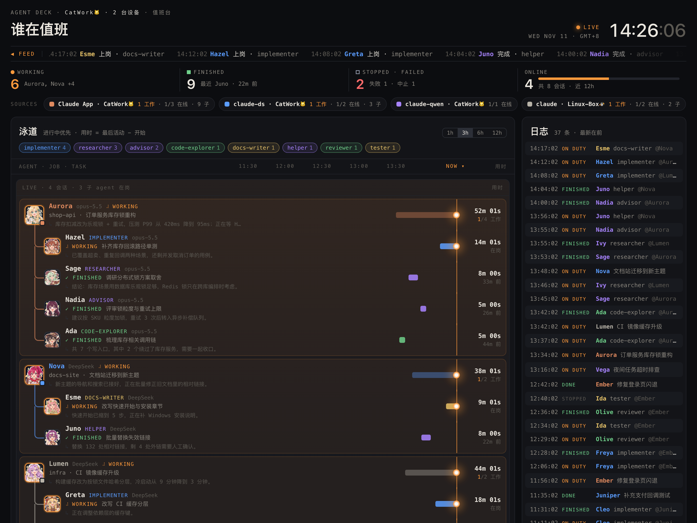
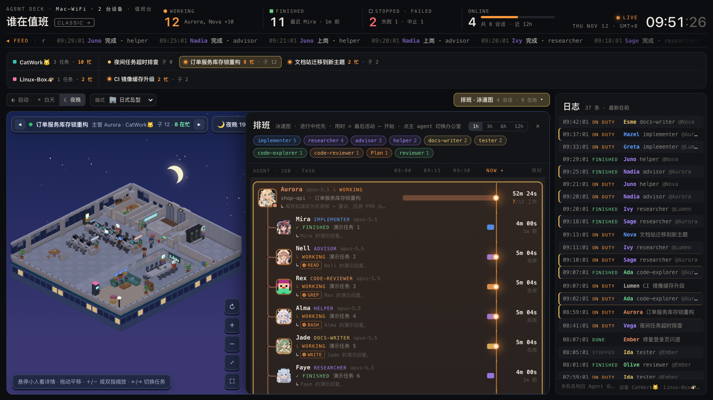

# Agent Deck（值班台）

多设备 Claude Code 多档位 agent 的实时值班面板：只读扫描各档位的配置目录，在浏览器里展示哪些会话在线、谁在工作、派出了哪些子 agent。

主视图是一间间“体素办公室”：一个任务（主 agent 会话）一间办公室，主管戴王冠坐课长席，子 agent 按任务类型去不同场景：干活的在工位，查资料 / 评审 / 讨论的去会议室，运维和 CI 去机房，完成后去休息区。上方任务栏按设备一行切换任务；排班（泳道图）与日志用来看细节；白天 / 夜晚主题随服务器时间自动切换。

hub（`server.py`）零依赖：Python 3 标准库 + 手写前端页面（`index.html` 主页面、`classic.html` 泳道看板，另有两个早期原型 `office.html`、`city.html`），无构建步骤、无外部脚本；推送采集器 `deck-push` 为 Rust 实现。



<sub>主页面（白天主题）：顶部是统计与 FEED 跑马灯，任务栏按设备分两行，下方办公室展示选中的任务，右侧是日志。</sub>



<sub>夜晚主题：点开“排班 · 泳道图”后，泳道抽屉从办公室右侧推出，办公室自动移到左侧剩余区域居中。</sub>

<sub>截图中的设备、任务与回复均为演示数据（基于 `tools/demo_push.py`）。</sub>

## 功能

主页面 `index.html` 自上而下：

- 顶部：值班台标题、WORKING / FINISHED / STOPPED·FAILED / ONLINE 四项统计、LIVE 与时钟、FEED 跑马灯。
- 任务栏：一台设备一行，左边是机器名与该机器的任务数 / 在忙人数，右边是这台机器上的任务标签（每个任务 = 一个主 agent 会话，显示状态点、任务名、在忙人数和子 agent 数；已结束的任务显示“已结束 · 多久前”）；标签多时可横向滚动，点击标签或按 `←` / `→` 切换下方办公室。已在 Claude App 里归档的会话会自动隐藏（见 `DECK_APP_SESSIONS_DIR`）；项目名（任务栏标签、办公室名牌、泳道）以全大写显示，下划线显示为空格，如 `Oh_My_Agent` 显示为 `OH MY AGENT`（只影响显示）。
- 常规栏：主题（自动 / 白天 / 夜晚，自动档按服务器时间切换，6:00–18:00 为白天）、办公室版式（5 种，“龙之圣堂”见下文）；右侧“排班 · 泳道图”按钮会从办公室右侧推出泳道图抽屉；宽屏（≥ 900px）下默认打开，手动开关后按你的选择记忆。
- 办公室：WebGL2 体素场景，只显示当前选中的任务。主管戴王冠坐课长席（标题是 CI / 运维类时去机房），子 agent 按自己的任务类型就位：编码、文档等干活的坐工位，查资料、评审、方案讨论去会议室，运维部署和 CI 去机房；最近完成的几位去休息区，其余完成的留在工位上亮“✓”气泡；每个任务最多 3 个岛、36 人（每岛 12 个子 agent）。天色默认跟随页面主题，也可单独选早上 / 中午 / 黄昏 / 夜晚（“龙之圣堂”版式固定为夜间火光，见下文）。
    - 悬停小人查看详情；排班抽屉开着时，点击小人可在排班里定位到对应条目。
    - 展开排班时，办公室移到左侧剩余区域居中；窄屏下抽屉仍以覆盖方式显示。
- 排班抽屉（泳道）：按子 agent 类型筛选；时间窗可选 1h / 3h / 6h / 12h；按 LIVE / RECENT 分组；主会话下挂子 agent 树。
- 右侧日志列。
- 全屏：办公室右下角 ⛶ 按钮，`Esc` 退出；访问 `/voxel` 直接以全屏办公室打开。浏览器不支持 WebGL2 时，办公室区域显示提示，其余部分照常工作。
- 整页只轮询一次 `/api/state`（每 3 秒），各区域共用。
- 每个主会话和子 agent 有固定的名字与头像，缺图时回退为像素小人 SVG。
- 多设备：多台设备推送到同一个 hub 时，档位标签带 “· 设备名”（如 `claude · CatWork🐱`）。
- `/classic`：原泳道看板（主页面已不再提供入口，只能直接访问该地址），保留 4 个统计卡和档位卡（每个档位的在线、工作中、会话数、子 agent 数，点击可显示/隐藏该档位；主页面没有档位卡）。版式参考过 squad.flikq.dev（本项目与其无关联）。

### 办公室版式：龙之圣堂

- 入口：常规栏“版式”下拉里的第 5 项“🐉 龙之圣堂”，也可用链接参数 `?layout=magic`；从下拉里选的版式和其它版式一样会记在浏览器本地。
- 场景：黑暗奇幻风格的破败地下圣堂，坐落在一块浮岩上。固定用夜间火光照明，不随时段条（早上 / 中午 / 黄昏 / 夜晚）和页面主题变化；背景是近黑的暗红色，不显示日月星辰。
- 站位：一个项目一座大法阵，不管有几个会话；法阵中央是龙蛋祭坛。各会话的主管（主 agent）站在法阵第一圈，子 agent 站在外圈、各自主管所在的扇区里，都面向法阵；工作中的举臂施法，头顶有光粒飞向法阵。这个版式里没有工位。
- 袍色：主管白袍；子 agent 按任务类别（即下文“任务类型分类”里的 `kind`）：编码红袍、运维黄袍、CI 橙袍、评审紫袍、方案蓝袍、调研绿袍、文档褐袍、其它灰袍；没有类别信息（`kind` 为 `null`）时按编码（红袍）处理。
- 功能区：去处规则与办公室完全相同，只换了造型：电梯 → 传送门，会议室 → 图书馆，休息区 → 礼拜堂（教堂长椅），机房 → 水晶密室，其余房间是仓库。
- 黑龙：趴在圣堂后墙外，由施法的人数召唤。
    - 没人工作时不出现；一个人工作时龙爪扒上墙头、只从墙后露出角；工作的人再多一些，双翼从墙后升起，龙先在墙后高高抬头，再越过墙头探进来，最后低头压向法阵；召唤进度到 0.8 以上（5 人以上的项目约 4 人在工作起）每 10 秒朝法阵喷 3 秒火。
    - 召唤进度的目标值：没人工作为 0；否则为 `min(1, 0.45 + 0.55 × (工作人数 − 1) / max(1, min(总人数, 5) − 1))`；进度 ≥ 0.8 时才会喷火。
- 画面：这个版式下，每个体素面按 1/8 格再切成小方块，逐块有细微的明暗差，镜头拉近能看到方块之间的缝；黑龙是在整数网格上雕刻的体素模型。其它四个版式的画面不变。
- 调试 / 演示：`?summon=0..1` 强制召唤进度（例如 `?layout=magic&summon=1`），方便截图和演示。
- 测试：`tests/summon.test.mjs`（`node:test`）覆盖召唤进度的三个纯函数 `summonTarget`、`summonStage`、`fireAt`；运行方式与 `tests/` 下其它前端测试相同：`node --test tests/*.test.mjs`。
- 实现：全部在 `index.html` 里，除测试外没有额外文件，也不引入依赖、没有构建步骤。

### 任务类型分类

每个小人只看**自己的标题**（主管 = 会话标题，子 agent = 子任务标题）判断任务类型，不看所属会话。服务端把标题批量交给 OpenAI 兼容的大模型接口，要求按 JSON 结构输出，结果按标题缓存在内存里，`/api/state` 里的主 agent 和子 agent 各带一个 `kind` 字段：

| kind | 含义 | 场景 |
| --- | --- | --- |
| `code` / `docs` / `other` | 编码实现 / 文档写作 / 其他 | 工位 |
| `research` / `review` / `plan` | 调研探索 / 评审核对 / 方案讨论 | 会议室 |
| `ci` / `ops` | 持续集成 / 运维部署 | 机房 |

主管只会去机房，其余时间守在课长席。模型输出会先整段解析，再去掉代码块、逐个尝试提取第一个完整 JSON 对象；空内容或解析失败立即重试（最多 3 次），接口出错按指数退避重试；被模型漏掉 3 次的标题归为 `other`。

配置（环境变量；docker compose 从同目录可选的 `.env` 读取，该文件 0600、不进仓库）：

| 变量 | 说明 |
| --- | --- |
| `DECK_LLM_URL` | OpenAI 兼容接口地址，形如 `https://<网关>/v1` |
| `DECK_LLM_KEY` | 接口密钥 |
| `DECK_LLM_MODEL` | 模型名，缺省 `deepseek` |
| `DECK_LLM_EFFORT` | 思考强度，缺省 `low`；填 `off` 不传该参数 |

没配 `DECK_LLM_URL` / `DECK_LLM_KEY`、接口不可用或还没分出结果时，`kind` 为 `null`，前端退回本地规则：标题里有独立的 “CI” 词去机房，子 agent 再按类型名（advisor、reviewer → 会议室；ops、helper → 机房）判断。

## 架构

三部分：

- **hub**：`server.py --mode hub`，用 docker compose 部署。只接收各设备的推送并提供页面，**不读宿主机任何文件**。唯一可选的密钥是任务分类用的大模型接口（见下文“任务类型分类”）。
- **推送采集器 `deck-push`**（Rust）：只读扫描本机各档位目录，定时推送到 hub。macOS 用 launchd 常驻，Linux 用 docker compose。
- **local 模式**（可选）：`server.py` 直接扫描本机并提供页面，不经过 hub，用 `docker-compose.local.yml` 或直接运行。

```text
设备 A (macOS)                设备 B (Linux)
 ~/.claude* 会话文件           ~/.claude 会话文件
      │ 只读扫描                    │ 只读扫描
      ▼                            ▼
  deck-push (launchd)         deck-push (docker)
      └──────── POST /api/ingest ──┘
                    ▼
        宿主机 nginx (反代, 推送接口仅内网)
                    ▼
        hub: 127.0.0.1:7788 (容器, server.py --mode hub)
                    ▲
                    │ GET /api/state (每 3 秒轮询)
                 浏览器
```

## 部署 hub

```bash
docker compose up -d
```

- 端口只绑定 `127.0.0.1:7788`，由宿主机 nginx 反代对外；参考 `deploy/nginx/agent-deck.conf`（域名示例 `agent-deck.example.com`）：
  - `POST /api/ingest` 只放行内网来源（按你的内网网段收窄，不要放行 docker 网桥网段）；带 `X-Forwarded-For` 的请求一律返回 403，防止经代理/隧道伪造内网来源。
- 不想用域名时，可在 compose 的 `ports` 里再加一行 `"<内网IP>:7788:7788"`（只绑内网网卡 IP，不要用 `0.0.0.0`），内网即可用 `http://<内网IP>:7788` 直接打开；此时推送来源由 `DECK_INGEST_ALLOW` 限制。
  - 该接口 `client_max_body_size 1m`，与服务端 `MAX_INGEST`（1MiB）一致；其余位置默认 64k，且只允许 `GET` / `HEAD`。
  - `/api/ingest` 与 `/api/state` 不记访问日志（每 3 秒一次）。
- 容器加固：`read_only`、非 root（uid 10001）、`cap_drop: ALL`、`no-new-privileges`，并限制内存 / 进程数 / CPU。
- 生产机不构建镜像时，可在其他机器 build 后用 `docker save | docker load` 传过去。
- 全部配置写在 compose 的 `environment`，不使用 `.env`，运行时无需任何密钥。

hub 环境变量（`server.py` 也有对应命令行参数，命令行优先）：

| 环境变量 | 默认值 | 说明 |
| --- | --- | --- |
| `DECK_MODE` | `local` | `hub` 或 `local`；compose 中为 `hub` |
| `DECK_HOST` | `127.0.0.1` | 监听地址；容器内为 `0.0.0.0`，对外由 `ports` 限制 |
| `DECK_PORT` | `7788` | 监听端口 |
| `DECK_NAME` | 主机名第一段 | 还没有设备推送时页面显示的名字 |
| `DECK_DEVICE_TTL` | `90` | 设备超过多少秒没推送就从面板移除 |
| `DECK_INGEST_ALLOW` | `127.0.0.0/8,10.0.0.0/8,172.16.0.0/12,192.168.0.0/16` | 允许写入 `/api/ingest` 的来源网段（逗号分隔 CIDR），其余返回 403；直接暴露端口、不经 nginx 时由它把关 |
| `TZ` | - | 容器时区，compose 中为 `Asia/Shanghai` |

## macOS 采集器

```bash
deploy/macos/install-push.sh <hub-url> <设备名> [sources.json]
# 例：deploy/macos/install-push.sh https://agent-deck.example.com 'CatWork🐱'
```

- `<hub-url>` 须以 `http://` 或 `https://` 开头；设备名必填，1–40 个字符且不含控制字符；`sources.json` 可选（见“档位配置”），安装前会用新二进制预检一次。
- 脚本会 `cargo build --release` 并安装二进制到 `~/Library/Application Support/agent-deck/`（不放在 `~/Documents` 等受 TCC 保护的目录，否则 launchd 进程读不了），登录即启动、`KeepAlive` 常驻。
- 日志：`~/Library/Logs/agent-deck/deck-push.log`，超过 1MiB 轮转，保留 `.1`–`.3` 共 3 份。
- 常用命令：

```bash
launchctl print gui/$UID/com.ohmyagent.deck-push | head -20   # 查看状态
tail -f ~/Library/Logs/agent-deck/deck-push.log               # 看日志
deploy/macos/uninstall-push.sh                                # 卸载（日志目录保留，可手动删除）
```

## Linux 采集器

编辑 `deploy/linux/docker-compose.push.yml`，把 `DECK_PUSH_URL` 改为你的 hub 地址、`DECK_NAME` 改为设备名（如 `Linux-Box🐧`），然后在仓库根目录执行：

```bash
docker compose -f deploy/linux/docker-compose.push.yml up -d --build
```

- 只读挂载 `projects` 与 `sessions` 两个子目录，不挂载整个配置目录，避免把凭据暴露给容器；容器 `read_only`、`cap_drop: ALL`。
- `DECK_PID_CHECK=0`：容器看不到宿主机进程，改用 `sessions/` 登记文件的新鲜度（`DECK_REGISTRY_TTL_HOURS`，默认 12 小时）判断会话是否在线。
- 日志走 docker `json-file`（单文件 5m，保留 2 份）：`docker logs agent-deck-push`。
- `TZ=CST-8`：alpine 镜像没有时区库，用 POSIX 写法表示 UTC+8，仅影响日志时间。
- DNS：部分内网 DNS 对 AAAA 查询返回 NXDOMAIN 时，musl 的 `getaddrinfo` 会整体解析失败；采集器内置了“系统解析失败后仅查 IPv4 再试一次”的回退解析。

## deck-push 参数与环境变量

命令行参数优先于环境变量。

| 参数 | 环境变量 | 默认值 | 说明 |
| --- | --- | --- | --- |
| `--push-url` | `DECK_PUSH_URL` | - | hub 地址；推送时必填 |
| `--name` | `DECK_NAME` | 主机名第一段 | 设备名，1–40 个字符 |
| `--interval` | `DECK_PUSH_INTERVAL` | `3` | 推送间隔（秒），范围 [1, 3600]，越界自动夹取 |
| `--hours` | `DECK_HOURS` | `12` | 回看小时数，范围 (0, 168]，超过 168 按 168 |
| `--sources` | `DECK_SOURCES` | 内置档位 | 档位 JSON 文件；环境变量则直接给 JSON 字符串 |
| - | `DECK_PID_CHECK` | `1` | `0` 时不检查进程，改用登记文件新鲜度 |
| - | `DECK_REGISTRY_TTL_HOURS` | `12` | 关闭 PID 检查时，登记文件多久未更新视为离线 |
| - | `DECK_APP_SESSIONS_DIR` | `~/Library/Application Support/Claude/claude-code-sessions` | Claude App 会话元数据目录，据此不再上报已在 App 里归档的会话（含子 agent）；设为空串关闭，目录不存在（如 Linux 容器）时无效果 |
| `--redact` | `DECK_REDACT` | 关 | 脱敏，见“隐私” |
| `--log-file` | `DECK_LOG_FILE` | stderr | 日志写入文件并按大小轮转 |
| - | `DECK_LOG_MAX_BYTES` | `1048576` | 单个日志文件上限 |
| - | `DECK_LOG_KEEP` | `3` | 轮转保留份数 |
| `--once` | - | - | 扫描一次，把 state JSON 打印到 stdout 后退出，不推送 |

**日志内容**：启动信息（设备、hub、档位、间隔、回看、PID 检查、脱敏开关）；首次推送成功（payload 字节数及 leads / agents / events 数量）；推送失败只在第 1、10 次和之后每 100 次记录；恢复推送（含此前失败次数）；每 10 分钟一条心跳汇总（成功/失败次数、payload 规模、平均扫描耗时、跳过文件数）；收到 SIGTERM/SIGINT 后写一行退出。

**失败退避**：失败 n 次后等待 `min(300, interval·2^n)` 秒再加 0–20% 抖动，上限 300 秒；成功后恢复正常间隔。

**推送前裁剪**：数量与字段长度对齐 hub 的清洗上限（档位 ≤16、leads ≤300、每个 lead 的 agents ≤200、全设备 agents ≤2000 且 working 优先、events ≤400，文本去控制字符后截断）；序列化后请求体上限 900KiB，超限时依次删除 RECENT 会话 → 从旧到新删非 working 子 agent → 清空最后回复 → 清空任务描述 → events 减半 → 只发档位与 working/idle 会话骨架。

## 档位配置

用 `--sources`（文件）或 `DECK_SOURCES`（JSON 字符串）传入，数组，每项：

| 字段 | 说明 |
| --- | --- |
| `id` | 档位 id，须匹配 `^[a-z0-9_-]{1,24}$` |
| `label` | 显示名 |
| `dir` | 该档位的配置目录，支持 `~` |
| `entry` | 按会话 `entrypoint` 过滤：`null` 不过滤，`"x"` 等于 x，`"!x"` 不等于 x。同一目录下多个档位按列表顺序匹配，先匹配到的生效 |
| `model_label` | 可选，该档位统一显示的模型名（如 claude-ds 显示 `DeepSeek`、claude-qwen 显示 `Qwen4`）；不设则显示真实模型名 |

```json
[
  {"id": "cli", "label": "claude", "dir": "~/.claude", "entry": null},
  {"id": "alt", "label": "claude-alt", "dir": "~/.claude-alt", "entry": null, "model_label": "DeepSeek"}
]
```

默认档位：

| id | 显示名 | 配置目录 | 入口过滤 | model_label |
| --- | --- | --- | --- | --- |
| `app` | Claude App | `~/.claude` | `claude-desktop` | - |
| `cli` | claude | `~/.claude` | `!claude-desktop` | - |
| `ds` | claude-ds | `~/.claude-deepseek` | 不过滤 | `DeepSeek` |
| `qwen` | claude-qwen | `~/.claude-qwen` | 不过滤 | `Qwen4` |

新增档位后，为新 `id` 加上颜色，否则会使用默认灰色。`index.html` 需改三处：

- CSS 变量 `--app` / `--cli` / `--ds` / `--qwen` 这一组，在 `:root`（夜晚）与 `:root[data-theme=light]`（白天）各有一份；
- 看板模块里的 `SRC_COLOR` / `SRC_HEX`；
- 体素场景里的 `SRC_HEX`。

`classic.html` 另有自己的一份 CSS 变量和 `SRC_COLOR` / `SRC_HEX`，如仍使用需同步修改。

## local 模式

```bash
python3 server.py [--port 7788] [--host 127.0.0.1] [--hours 12] [--sources sources.json]
# 或
docker compose -f docker-compose.local.yml up -d --build
```

然后打开 `http://127.0.0.1:7788`。前端每 3 秒轮询一次 `/api/state`。compose 版以 root 运行（需读取权限为 600 的会话文件），只读挂载各档位的 `projects` 与 `sessions`，并设置 `DECK_PID_CHECK=0`。`server.py` 同样支持环境变量 `DECK_APP_SESSIONS_DIR`（含义与默认值见“deck-push 参数与环境变量”），直接运行时会隐藏已在 Claude App 里归档的会话；compose 版没有挂载该目录，默认不生效。

## 数据来源与状态判定

只读扫描，不修改任何 hook 或配置：

- `sessions/<pid>.json`：进程是否存活，以及 busy / idle 状态。
- `projects/**/<session>.jsonl`：会话开始时间、模型、标题、cwd、最后一条回复。项目名取 cwd 的最后一段目录；工作树会话（`<仓库>/.claude/worktrees/<名字>`）归到所属仓库名，与 Claude App 侧边栏一致。
- `projects/**/<session>/subagents/agent-*.jsonl` 与同名 `.meta.json`：子 agent 类型（`agentType`）、任务描述、模型、起止时间。
- Claude App 会话元数据（`DECK_APP_SESSIONS_DIR` 下的 `local_*.json`）：只取 `isArchived` 与关联的 CLI 会话 id，已归档的会话不显示。

大文件只读头尾部分，并按 (mtime, size) 缓存解析结果。

### 主会话

| 状态 | 条件 |
| --- | --- |
| `working` | 进程存活且 busy；或无存活进程记录，但文件在 90 秒内有写入；或有子 agent 正在工作 |
| `idle` | 进程存活且不是 busy |
| `done` | 无存活进程，且最后一条 assistant 正常结束 |
| `stopped` | 无存活进程，且最后一条 assistant 未正常结束 |

主会话处于 `idle` / `done` / `stopped` 时，只要有子 agent 在工作，就显示为 `working`。「在线」= `working` + `idle`。

### 子 agent

| 状态 | 条件 |
| --- | --- |
| `working` | 记录文件在 90 秒内有写入 |
| `finished` | 最后以 `SubagentHandback` 交回结果视为完成（或正常 `end_turn`） |
| `failed` | 没有任何 assistant 消息 |
| `stopped` | 其余情况（不再写入且未正常结束） |

## 页面展示的数据与隐私

页面会展示：会话标题（取自会话自定义标题 / agent 名；都没有时用项目名，不再用用户提示词兜底）、项目名、分支、子 agent 类型与任务描述、模型名、起止时间、状态，以及**最后一条回复（每条 ≤400 字）**和**正在调用的工具名**。回复只取文字（跳过思考与工具调用；末尾窗口里没有文字时沿用上一次的回复，首次最多往前回看 4MiB）；工具只上传名字（如 `⚙ Edit`），不上传参数与结果。不上传对话全文和文件内容。

- 面板公开部署时，上述内容对所有访问者可见，公开部署时请注意这一点。
- 推送端可开启 `--redact`（`DECK_REDACT=1`）脱敏：标题只用项目名，不上报分支、子 agent 任务描述和最后回复。脱敏由 `deck-push` 实现，local 模式的 `server.py` 没有该开关。
- `/api/ingest` 无密钥，访问控制依赖 nginx 的内网限制，见“部署 hub”。
- 服务与采集器只读取各档位配置目录与 Claude App 会话元数据目录下的文件，不写入、不修改。
- `tools/gen_avatars.py` 所需的接口地址与密钥只通过环境变量提供，不要写入仓库；`.env` 已被 `.gitignore` 忽略。

## 演示数据

不接真实设备也能看效果：起一个 hub，再推一份仿真数据（两台虚构设备，不读取任何真实会话）。设备超过 `DECK_DEVICE_TTL`（默认 90 秒）没推送会从面板消失，需要时重复执行推送即可。

```bash
python3 server.py --mode hub --port 7799 &
python3 tools/demo_push.py http://127.0.0.1:7799
```

然后打开 `http://127.0.0.1:7799`。

## API

| 接口 | 说明 |
| --- | --- |
| `GET /`、`/index.html` | 新主页面 `index.html`（任务栏 + 体素办公室） |
| `GET /voxel`、`/voxel.html` | 同样返回 `index.html`，用于直接以全屏办公室打开 |
| `GET /classic`、`/classic.html` | 原泳道看板 `classic.html` |
| `GET /office`、`/office.html` | 早期原型：SVG 等距办公室 `office.html` |
| `GET /city`、`/city.html` | 早期原型：体素城市楼宇 `city.html` |
| `GET /api/state` | 当前状态 JSON（hub 模式合并所有在线设备，缓存约 1 秒） |
| `POST /api/ingest` | 仅 hub 模式：设备推送 `{"device": 名字, "state": {...}}`。成功 `204`；设备名无效或 payload 畸形 `400`；请求体为空或超过 1MiB `413` |
| `GET /healthz` | 健康检查，返回 `ok` |
| `GET /avatars/<name>.png` | 头像图片 |

`/api/state` 顶层字段：

| 字段 | 说明 |
| --- | --- |
| `now` | 当前时间（毫秒时间戳） |
| `hours` | 回看小时数 |
| `host` | 设备名（多设备时为 “名字 · N 台设备”） |
| `devices` | hub 模式：在线设备的 `name` 与距上次推送的 `age`（秒） |
| `sources` | 各档位统计：`online` / `working` / `sessions` / `agents` |
| `leads` | 主会话列表，每项含状态、模型、标题、项目、最后回复及其子 agent `agents` |
| `events` | 事件流（按时间倒序，最多 400 条） |
| `avatars` | 可用头像名列表 |

hub 对推送内容的清洗与上限：

- 设备名 1–40 个字符且不含控制 / 格式字符；最多同时保留 8 台设备，超出时淘汰最久没推送的。
- 每台设备 agents ≤2000、leads ≤300、events ≤400；文本去掉控制字符与 Unicode 格式字符（如方向覆盖、零宽字符）后截断；请求体 ≤1MiB。
- 设备时钟与 hub 偏差超过 2 秒时，该设备所有时间戳自动平移校正到 hub 时间。
- 设备超过 `DECK_DEVICE_TTL` 秒没推送即从面板移除。

## 头像

`avatars/roster.json` 定义 8 个队长（主会话）和 22 个船员（子 agent），全部为原创女性角色（贴纸风 · 奇幻冒险画风 · 元气表情），名字与头像一一绑定，按会话 / agent id 的哈希分配。头像文件为 `avatars/<name 小写>.png`；缺图时前端回退到像素小人 SVG。

用 `tools/gen_avatars.py` 生成头像，调用 OpenAI 兼容的 `/v1/images/generations` 接口。连接信息只从环境变量读取：

| 环境变量 | 说明 |
| --- | --- |
| `IMG_BASE_URL` | 接口基础地址，缺省回退 `LLM_BASE_URL` |
| `IMG_API_KEY` | 接口密钥，缺省回退 `LLM_API_KEY` |
| `IMG_MODEL` | 模型名，缺省 `gpt-image` |
| `IMG_QUALITY` | 可选，如 `high`；不设则用接口默认档 |

```bash
python3 tools/gen_avatars.py [--only Ada,Bram] [--force] [-j 4] [--size 192]
```

- `--only`：只生成指定名字（逗号分隔）。
- `--force`：覆盖已存在的头像（默认已存在则跳过）。
- `-j`：并发数，默认 4。
- `--size`：输出边长，默认 192。缩放使用 macOS 的 `sips`；没有 `sips` 时保存原图。
